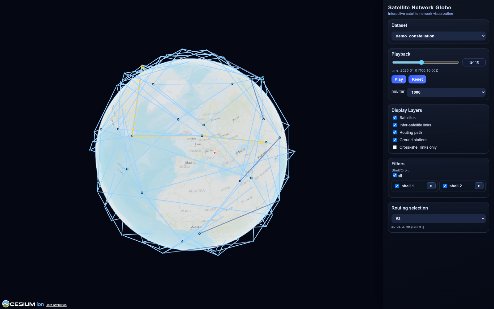
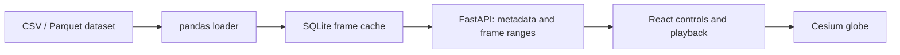

# Satellite Visual Simulator

An interactive 3D viewer for satellite network simulation outputs. Explore satellite
positions, inter-satellite links, degraded connections, and routing paths over time
on a Cesium globe.

Built with **React, TypeScript, Cesium, FastAPI, pandas, and SQLite**. The repository
includes a reproducible synthetic dataset so the demo runs without external files
or API keys.



## Features

- Timeline playback with adjustable speed and interpolation between frames.
- Satellite hover details and filters by shell and orbital plane.
- Independent layers for satellites, links, routes, and ground stations.
- Cross-shell link filtering and visual distinction for degraded links.
- Route selection with satellite endpoints and task status.
- Dataset switching and frame loading in windows rather than one large response.
- Persistent SQLite frame cache, rebuilt when source file signatures change.

## Quick start with Docker

From the repository root, with Docker and the Compose plugin installed:

```bash
docker compose up --build -d
```

Open **http://localhost:8080**. The API documentation is at
http://localhost:8000/docs. Both ports bind to the local machine by default.

The bundled demo has **96 satellites, 24 frames, two shells, three routes, and three
fictional ground stations**. Press **Play**, drag the timeline, inspect a satellite,
and select a route. Frames 8–15 demonstrate degraded links.
Try the shell/orbit filters and the **Cross-shell links only** layer option.

```bash
curl -f http://localhost:8080/api/health
docker compose down
```

Cached frames persist in the ignored `satellite_db_cache/` directory.

## Local development

Use **Python 3.11 or 3.12** and **Node.js 22.12 or newer**.

```bash
python -m venv .venv
source .venv/bin/activate
python -m pip install -r backend/requirements.txt
cd frontend
npm ci
cd ..
./start.sh
```

Open http://localhost:5173. The script starts both services and stops them when you
press Ctrl+C. Set `PYTHON_BIN` to use an existing Python environment, or set
`API_PORT`, `FRONTEND_PORT`, and `UVICORN_RELOAD=1` as needed.

You can also run the services in separate terminals:

```bash
# Terminal 1, repository root, virtual environment activated
python -m uvicorn app.main:app --app-dir backend --reload --host 127.0.0.1 --port 8000

# Terminal 2
cd frontend
npm run dev -- --host 127.0.0.1
```

Vite proxies `/api` to the backend. An optional `frontend/.env.local` can use the
settings in [frontend/.env.example](frontend/.env.example).

## How it works



The backend converts dataset rows into frames containing satellites, links, routes,
and ground stations. A manifest records file sizes, modification times, SHA-256
hashes, row counts, and the cache schema version. Source changes trigger a rebuild.
The frontend fetches metadata first, requests frame windows, and interpolates
satellite positions for smooth playback. Dataset request IDs prevent late responses
from a previous selection from replacing the active dataset.

## Bring your own dataset

See [the dataset format](docs/datasets.md) for required columns, units, and examples.
Keep local data in the ignored `data/` directory. For example:

```bash
SATELLITE_DATA_ROOT="$PWD/data" \
SATELLITE_DATA_PATH="$PWD/data/my_dataset" \
./start.sh
```

For Docker, use the included mount override:

```bash
docker compose -f docker-compose.yml -f docker-compose.data.yml up --build -d
```

Place datasets in `data/<dataset-name>/`, then select one in the UI. Dataset API
parameters accept directory names; server filesystem paths are kept out of responses.

## Validation

```bash
python -m pip install -r backend/requirements-dev.txt
python -m unittest discover -s backend/tests -v
cd frontend
npm run build
```

GitHub Actions runs the API tests and production frontend build. Tests cover demo
playback, frame ranges, cache invalidation, dataset path boundaries, and API error
responses that omit local paths.

Regenerate the deterministic sample with:

```bash
python scripts/generate_demo.py
```

## Scope and tradeoffs

This project visualizes simulation results; it does not compute routing decisions or
validated orbital dynamics. The bundled coordinates and network metrics are
illustrative. [Demo data details](demo_data/README.md) describe their construction.

Globe imagery uses ESRI map tiles and requires an internet connection. Cesium also
requires a browser with WebGL support. The backend keeps source signatures accurate
by reading files during cache validation, so very large datasets may benefit from
additional ingestion and indexing work. The current setup is designed for local
exploration; an internet deployment needs its own access control and hosting setup.

## Repository layout

```text
backend/app/        API, data normalization, and SQLite cache
backend/tests/      API and cache regression tests
frontend/src/       Globe renderer, playback controls, and API client
demo_data/          Generated sample dataset
docs/              Dataset integration guide
scripts/           Demo generation and portable source export
```

A portable source archive can be created with `python scripts/export_public.py`.
It includes the demo and source files, excludes local data and credentials, and
contains no Git history.
