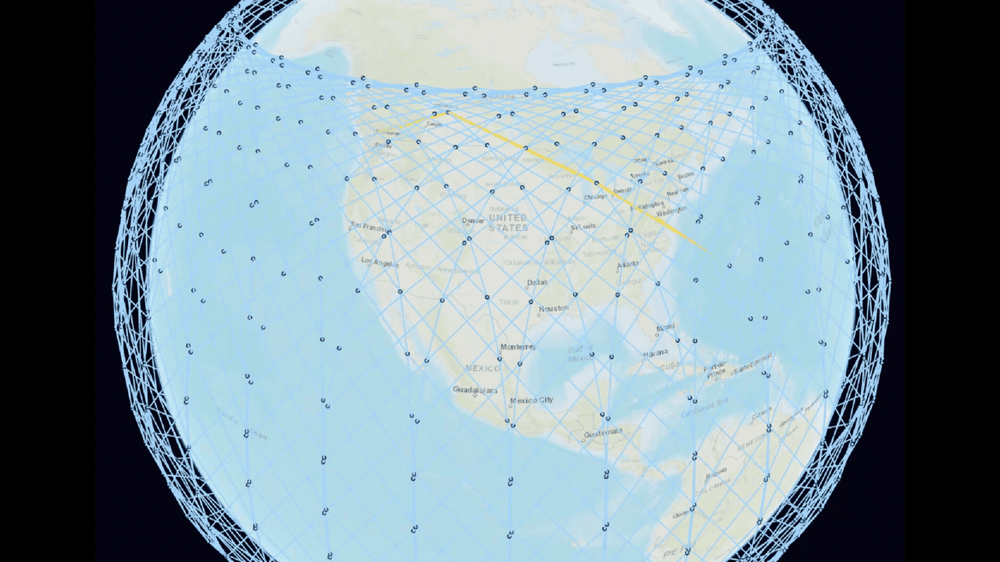

# Satellite Visual Simulator

A browser-based 3D viewer for satellite network simulation outputs. Replay satellite
positions, inter-satellite links, and routing paths on a Cesium globe, then pause to
inspect individual satellites or isolate part of the constellation.

Built with React, TypeScript, Cesium, FastAPI, pandas, and SQLite. A complete
four-hour demonstration dataset is included, so you can try the viewer without
running an external simulator or supplying API keys.



*Recorded playback; the yellow line marks the selected route. The GIF shows the
globe view, not the full set of controls.*

## Viewer controls

The interface also provides:

| Control | What it does |
| --- | --- |
| **Shell / orbit hierarchy** | Toggle whole shells, or expand a shell to select individual orbital planes. |
| **Satellite hover details** | Pause playback and hover over a satellite to see its name, ID, shell, orbit, latitude, longitude, and altitude. |
| **Display layers** | Show or hide satellites, inter-satellite links, the selected route, and ground stations independently. Use **Cross-shell links only** to isolate links between shells. |
| **Playback and camera** | Play, pause, reset, or scrub the timeline. Use **0.1×–10000×** playback relative to recorded simulation time; drag to rotate the globe and scroll to zoom. |
| **Route selection** | Highlight a route and read its source/destination satellite IDs, task state, and recorded method. A warning appears when shell/orbit filters hide the selected route. |
| **Dataset switching** | Choose among datasets in the configured data directory without restarting the services. |

## Quick start with Docker

From the repository root, with Docker and the Compose plugin installed:

```bash
docker compose up --build -d
```

Open **http://localhost:8080**. The API documentation is at
http://localhost:8000/docs. Both ports bind to the local machine by default.

The bundled demo has **1,584 satellites in shell 0 across 72 orbital planes,
480 frames at 30-second intervals, one Vancouver → Washington, D.C. connection,
and one illustrative destination ground station**. The recording covers four
hours and uses a generated constellation rather than live satellite observations.

At 1×, each 30-second interval takes 30 real seconds. Select 100× or 500× to see
the constellation move more quickly, then pause to try the hover details and
filters. Speeds of 100× and above buffer all frames before playback advances;
the first cache build and frame buffering can take longer than later loads.

```bash
curl -f http://localhost:8080/api/health
docker compose down
```

Cached frames persist in the ignored `satellite_db_cache/` directory.

## Local development

Use **Python 3.11 or 3.12** and **Node.js 22.12 or newer**.

```bash
python -m venv .venv
source .venv/bin/activate
python -m pip install -r backend/requirements.txt
cd frontend
npm ci
cd ..
./start.sh
```

Open http://localhost:5173. The script starts both services and stops them when you
press Ctrl+C. Set `PYTHON_BIN` to use an existing Python environment, or set
`API_PORT`, `FRONTEND_PORT`, and `UVICORN_RELOAD=1` as needed.

You can also run the services in separate terminals:

```bash
# Terminal 1, repository root, virtual environment activated
python -m uvicorn app.main:app --app-dir backend --reload --host 127.0.0.1 --port 8000

# Terminal 2
cd frontend
npm run dev -- --host 127.0.0.1
```

Vite proxies `/api` to the backend. An optional `frontend/.env.local` can use the
settings in [frontend/.env.example](frontend/.env.example).

## How it works

The backend loads CSV or Parquet files into a SQLite frame cache and serves them
through FastAPI. It checks source file signatures and rebuilds the cache when the
data changes. The frontend fetches frames in windows and interpolates satellite
positions between frames for smooth playback. It reads recorded timestamps to
keep the playback multiplier and UTC clock consistent with the simulation step.
Fast playback loads the complete recording in batches.

## Bring your own dataset

See [the dataset format](docs/datasets.md) for required columns, units, and examples.
Keep local data in the ignored `data/` directory. For example:

```bash
SATELLITE_DATA_ROOT="$PWD/data" \
SATELLITE_DATA_PATH="$PWD/data/my_dataset" \
./start.sh
```

For Docker, use the included mount override:

```bash
docker compose -f docker-compose.yml -f docker-compose.data.yml up --build -d
```

Place datasets in `data/<dataset-name>/`, then select one in the UI. Dataset API
parameters accept directory names; server filesystem paths are kept out of responses.

## Validation

```bash
python -m pip install -r backend/requirements-dev.txt
python -m unittest discover -s backend/tests -v
cd frontend
npm test
npm run build
```

GitHub Actions runs the API tests, bundled dataset validation, playback tests, and
production frontend build. Checks cover frame ranges, cache invalidation, dataset
path boundaries, errors that omit local paths, recorded timing, and route edges
that exist in the corresponding frame's link graph.

Validate the bundled recording with:

```bash
python scripts/validate_dataset.py demo_data/demo_constellation
```

The bundled recording is an export from a separate simulator. The included small
fixture generator creates an independent, deterministic 96-satellite example for
development and tests:

```bash
python scripts/generate_demo.py
```

Its default output is `data/synthetic_constellation/`. Use the local-data setup
above to view it; generating the fixture does not overwrite the bundled recording.

To prepare a new simulator export for the public demo, keeping the full recording
while excluding unused diagnostic tables:

```bash
python scripts/prepare_demo_data.py data/my_simulator_export
```

The source must include the matching link Parquet and shell/orbit fields in its
positions. The command validates the export before copying the viewer inputs.

## Scope and tradeoffs

This project replays simulation results; it does not calculate routes or propagate
orbits. The bundled constellation is generated and the destination gateway is
illustrative; the data does not describe a verified operational satellite network.
[Demo data details](demo_data/README.md) describe their construction. Degraded-link
flags and optional route metrics are returned by the API, but the current viewer
does not give degraded links a separate style or display a route-metrics panel.
The recorded `VISUAL_DEMO` method was used to prepare the visualization demo in
the external simulator; the viewer only replays its exported paths.

Globe imagery uses ESRI map tiles and requires an internet connection. Cesium also
requires a browser with WebGL support. The backend keeps source signatures accurate
by reading files during cache validation, so very large datasets may benefit from
additional ingestion and indexing work. The current setup is designed for local
exploration; an internet deployment needs its own access control and hosting setup.

The bundled data occupies about **64.58 MiB**. The position CSV is 64.46 MiB;
the link Parquet retains only the four columns used by the viewer. Full research
logs, simulator configuration, and redundant usage exports are kept outside the
public sample. See [GitHub's file-size limits](https://docs.github.com/en/repositories/working-with-files/managing-large-files/about-large-files-on-github)
when adding larger recordings.

## Repository layout

```text
backend/app/        API, data normalization, and SQLite cache
backend/tests/      API and cache regression tests
frontend/src/       Globe renderer, playback controls, and API client
demo_data/          Complete generated-constellation demo recording
docs/              Demo GIF and dataset integration guide
scripts/           Demo generation and portable source export
```
